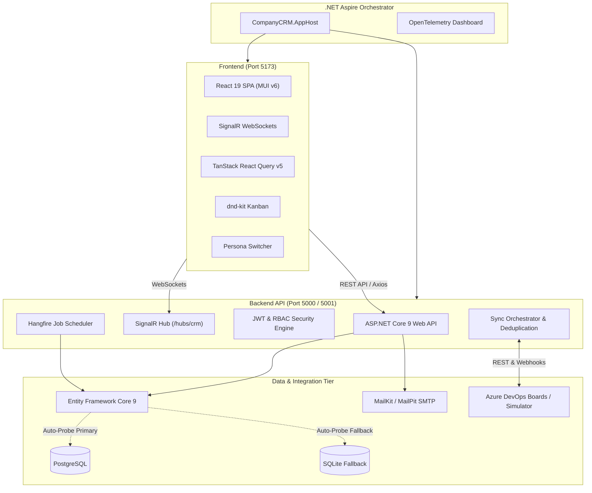

# CompanyCRM

[](https://dotnet.microsoft.com/)
[](https://react.dev/)
[](https://www.typescriptlang.org/)
[](https://vitejs.dev/)
[](https://mui.com/)
[](https://learn.microsoft.com/ef/core/)
[](https://learn.microsoft.com/dotnet/aspire/)
[](https://www.postgresql.org/)
[](https://www.sqlite.org/)
[](https://www.hangfire.io/)
[](https://dotnet.microsoft.com/apps/aspnet/signalr)
[](LICENSE.txt)

**CompanyCRM** is a modern, enterprise-grade CRM, Project Management, and Time-Tracking platform designed to bridge executive leadership, project managers, and software delivery teams. Built on **Clean Architecture**, **.NET 10**, and **React 19**, it offers end-to-end work item governance, automated planning cutoff enforcement, real-time profitability analytics, and bidirectional external issue synchronization.

---

## 📑 Table of Contents

- [Key Capabilities](#-key-capabilities)
- [Architecture & Tech Stack](#-architecture--tech-stack)
- [Solution Structure](#-solution-structure)
- [Getting Started ("How to Use It")](#-getting-started-how-to-use-it)
  - [Prerequisites](#prerequisites)
  - [Running with .NET Aspire (Recommended)](#option-a-running-with-net-aspire-recommended)
  - [Running Standalone (Manual Backend + Frontend)](#option-b-running-standalone-manual-backend--frontend)
  - [Service Endpoints & Dashboards](#service-endpoints--dashboards)
- [Demo Personas & Role-Based Access](#-demo-personas--role-based-access)
- [Testing & Quality Assurance](#-testing--quality-assurance)
- [Project Roadmap ("What I Plan to Do With It")](#-project-roadmap-what-i-plan-to-do-with-it)
- [License](#-license)

---

## 🌟 Key Capabilities

### 1. Agile Workspace & Interactive Kanban Board
- **Drag-and-Drop Workflow**: Smooth Kanban column transitions driven by `@dnd-kit`.
- **Backlog DataGrid**: Fast sorting, pagination, and multi-criteria filtering with `@mui/x-data-grid`.
- **Integrated Timer Drawer**: Start, pause, and log billable and non-billable time directly against tasks.
- **Detailed Work Item Drawer**: Edit titles, acceptance criteria, story points, estimated hours, and assignees.

### 2. Work Item Lifecycle & Review Governance
- Enforces a rigorous 9-stage status state machine:


Draft → PendingReview → {

    ClarificationRequested
    
    Denied
    
    Approved → Backlog → Todo → InProgress → InVerify → Done
}

- Team leads and higher management can inspect incoming submissions in the **Review Queue**, attach revision notes, and grant approvals before work enters active sprints.
- Complete audit history logging records every property change, actor, and timestamp.

### 3. Daily & Weekly Planning with Automated Cutoffs
- **Daily Commitments & Standups**: Team members declare specific planned tasks and target hours for the workday.
- **Weekly Strategic Roadmaps**: Markdown-formatted weekly goals, deliverables, and focus areas.
- **Enforced Planning Cutoffs**: Configurable per-project cutoff times (e.g., 09:30 AM EST) with weekend exclusion rules.
- **Automated Reminders**: Recurring Hangfire workers identify unsubmitted plans, trigger reminder emails via MailKit, and lock modifications past cutoffs.

### 4. Executive Management & Profitability Analytics
- **Role-Gated Portal**: Strictly restricted to `HigherManagement` through ASP.NET Core authorization policies and React route guards.
- **Real-Time Financial Precision**: Live gross margin calculation factoring in employee annual base salary, hourly cost rate, and client billable rates.
- **Interactive Visualizations**:
  - **Burndown Charts**: Track sprint burn rate and scope completion over time.
  - **Velocity Charts**: Measure completed story points and estimated vs. actual hours across cycles.
  - **Hours Comparison & Utilization**: Billable vs. non-billable time breakdown per employee and department.

### 5. Employee Directory & Skills Matrix
- Complete organization roster tracking job titles, departments, weekly capacity hours, and seniority ranks (`Junior`, `Mid`, `Senior`, `Lead`, `Principal`).
- **5-Tier Skills Taxonomy**: Visual skill proficiencies (1 to 5) and years of experience across Architecture, Backend, Frontend, DevOps, Database, and QA categories.

### 6. Bidirectional External Issue Tracker Sync
- **Multi-Provider Adapters**: Pull and push work items between CompanyCRM and **Azure DevOps Boards**, **Atlassian Jira (Cloud / Data Center)**, or **GitHub Issues & Pull Requests** (each includes a full-fidelity built-in simulator for offline or local testing).
- **Anti-Loop Prevention**: SHA-256 state hashing prevents infinite webhook echo loops between external and internal trackers.
- **Conflict Resolver**: Visual diff interface enabling users to resolve merge conflicts when fields are changed concurrently in both systems.

### 7. Dual-Mode Persistence Architecture
- Seamless database probe engine automatically connects to **PostgreSQL** in production or Docker environments, with immediate, zero-configuration fallback to local **SQLite** when no Postgres instance is reachable.

### 8. Real-Time SignalR Engine
- Hub endpoint at `/hubs/crm` pushes immediate notifications to connected browsers on work item updates, review decisions, timer state changes, and sync events without requiring page refreshes.

---

## 🏗 Architecture & Tech Stack



### Technology Breakdown

| Tier | Technologies |
| :--- | :--- |
| **Backend Framework** | .NET 10, ASP.NET Core Web API, C# 13 / 14 |
| **Architecture** | Clean Architecture / Domain-Driven Design (Domain, Application, Infrastructure, Api) |
| **Data & ORM** | Entity Framework Core 10, Npgsql (PostgreSQL), Microsoft.EntityFrameworkCore.Sqlite |
| **Background Scheduling** | Hangfire (Memory Storage), Recurring Jobs |
| **Real-Time Push** | ASP.NET Core SignalR |
| **Email Delivery** | MailKit (SMTP / MailPit) with in-database fallback logging |
| **Frontend Framework** | React 19, TypeScript, Vite 6 |
| **UI & Styling** | Material UI (MUI v6), Emotion, MUI X Data Grid |
| **State & Data Fetching** | TanStack React Query v5, Axios |
| **Drag & Drop** | `@dnd-kit/core`, `@dnd-kit/sortable` |
| **Charts & Analytics** | Recharts |
| **Orchestration & Observability** | .NET Aspire 9 (`AppHost`, `ServiceDefaults`), OpenTelemetry, Health Checks |
| **Testing** | xUnit, WebApplicationFactory, FluentAssertions, Moq, Playwright/Node stress test suite |

---

## 📁 Solution Structure

```
CompanyCRM/
├── CompanyCRM.sln                      # Visual Studio / dotnet solution
├── global.json                         # Pins .NET SDK 9.0
├── src/
│   ├── CompanyCRM.AppHost/             # .NET Aspire distributed application orchestrator
│   ├── CompanyCRM.ServiceDefaults/     # OpenTelemetry, health checks, HTTP resilience
│   ├── CompanyCRM.Domain/              # Pure domain entities, enums, value objects
│   ├── CompanyCRM.Application/         # Interfaces, DTOs, business rules
│   ├── CompanyCRM.Infrastructure/      # EF Core DbContext, Repositories, Hangfire, MailKit, ADO
│   ├── CompanyCRM.Api/                 # REST Controllers, SignalR Hub, JWT, Swagger
│   └── companycrm-web/                 # React 19 + TypeScript + Vite frontend
└── tests/
    └── CompanyCRM.Tests/               # Unit, integration, security RBAC, and stress tests
```

---

## 🚀 Getting Started ("How to Use It")

### Prerequisites

- [.NET 9.0 SDK](https://dotnet.microsoft.com/download/dotnet/9.0) (pinned in `global.json`)
- [Node.js](https://nodejs.org/) (v20+ LTS recommended) and `npm`
- *(Optional)* [Docker Desktop](https://www.docker.com/) if running PostgreSQL or MailPit locally. If not present, the app automatically runs against SQLite!

---

### Option A: Running with .NET Aspire (Recommended)

.NET Aspire orchestrates both the backend API and the frontend Vite server in a single unified process with real-time distributed telemetry.

1. Clone the repository and navigate to the project root:
   ```bash
   git clone https://github.com/your-org/CompanyCRM.git
   cd CompanyCRM
   ```

2. Restore and run via the Aspire AppHost:
   ```bash
   dotnet run --project src/CompanyCRM.AppHost
   ```

3. Open the **Aspire Dashboard** URL displayed in your terminal to view health metrics, traces, and single-click access to both the frontend web app and backend API.

---

### Option B: Running Standalone (Manual Backend + Frontend)

If you prefer launching each tier independently:

#### 1. Start the Backend API
```bash
dotnet run --project src/CompanyCRM.Api
```
- The API will start on `http://localhost:5000` (and `https://localhost:5001`).
- The database is automatically created and seeded with comprehensive demo personas, work items, and projects on startup.
- Swagger UI will be accessible at: `http://localhost:5000/swagger`.

#### 2. Start the React Frontend
Open a second terminal:
```bash
cd src/companycrm-web
npm install
npm run dev
```
- The Vite development server will start on `http://localhost:5173`.
- Open `http://localhost:5173` in your browser.

---

### Service Endpoints & Dashboards

| Service | URL | Description |
| :--- | :--- | :--- |
| **Frontend Web App** | `http://localhost:5173` | React 19 UI with Kanban, Analytics, and Planning |
| **REST API Swagger** | `http://localhost:5000/swagger` | Interactive OpenAPI documentation and test client |
| **Hangfire Dashboard** | `http://localhost:5000/hangfire` | Monitor background cutoff jobs and sync tasks |
| **SignalR Hub** | `http://localhost:5000/hubs/crm` | Real-time WebSocket connection endpoint |
| **Health Checks** | `http://localhost:5000/health` | Service health status |

---

## 👥 Demo Personas & Role-Based Access

The database is pre-seeded with 6 distinct personas representing all organizational tiers. In the development UI, use the **Persona Switcher** in the top navigation header to switch users instantaneously without typing credentials:

| Persona | Role | Department | Access Level & Key Features |
| :--- | :--- | :--- | :--- |
| **Eleanor Vance** | `HigherManagement` | Executive | Chief Operating Officer. Full access to the **Management Portal**, real-time financial margins, profitability grids, and organization-wide KPIs. |
| **Marcus Brody** | `HigherManagement` | Engineering | VP of Engineering. Executive oversight, compensation insights, engineering velocity, and burndown analytics. |
| **Sarah Jenkins** | `TeamLead` | Engineering | Engineering Manager & Lead Architect. Access to **Review Queue**, approval/denial of work items, and sprint capacity management. |
| **David Chen** | `TeamLead` | QA | QA & Delivery Lead. Review queue evaluations, verification flows, and cutoff planning compliance. |
| **Alex Rivera** | `Employee` | Engineering | Senior Full Stack Developer. Active work item execution, daily standup plans, time tracking timer, and sync conflict views. |
| **Maya Patel** | `Employee` | Frontend | Frontend UI/UX Developer. Kanban interactions, task completion, skill matrix self-service, and weekly plans. |

---

## 🧪 Testing & Quality Assurance

CompanyCRM comes with an extensive suite of domain invariant tests, RBAC security verification, financial precision audits, and high-concurrency sync tests.

### Running Backend Unit & Integration Tests
```bash
dotnet test tests/CompanyCRM.Tests/CompanyCRM.Tests.csproj
```

The test suite covers:
- **Financial Calculation Invariants**: Verifying gross profit margin formulas, billable vs. cost calculations, and zero-division defenses.
- **RBAC Security Boundaries**: Enforcing that `Employee` accounts are strictly forbidden from viewing management analytics or compensation data.
- **Sync Loop Prevention**: Verifying that incoming webhooks bearing identical SHA-256 hashes are discarded idempotently.
- **Review State Machine**: Validating transition rules from `Draft` to `PendingReview` to `Approved`/`Denied`.

### Building Frontend Client
```bash
cd src/companycrm-web
npm run build
```

---

## 🗺 Project Roadmap ("What I Plan to Do With It")

The following strategic initiatives represent the planned evolution of CompanyCRM:

```
┌────────────────────────────────────────────────────────────────────────┐
│                        COMPANYCRM PRODUCT ROADMAP                      │
└────────────────────────────────────────────────────────────────────────┘

  [Phase 1: Extended Integrations]
  ├── ✅ Jira Cloud & Data Center Bi-directional Sync Adapter
  ├── ✅ GitHub Issues & Pull Requests Connector
  └── Slack & Microsoft Teams Webhooks (Cutoff Reminders & Review Alerts)

  [Phase 2: Billing & Invoice Automation]
  ├── Automated Monthly PDF Invoicing Engine
  ├── Stripe Billing & QuickBooks / Xero Accounting Export
  └── Client Retainer Tracking & Budget Overage Alarms

  [Phase 3: AI-Assisted Operations]
  ├── Natural Language Daily Standup Aggregator (AI Roll-up Summaries)
  ├── Sprint Retrospective Sentiment & Bottleneck Detector
  └── Intelligent Capacity Balancer (Matching backlog tasks to developer skills)

  [Phase 4: Mobile & Offline Capabilities]
  ├── Offline-first Progressive Web App (PWA) / React Native Mobile App
  ├── Local SQLite Caching for Field Technicians
  └── Mobile Push Notifications for Daily Planning Cutoffs

  [Phase 5: Multi-Tenant Enterprise Tier]
  ├── Organization & Tenant Isolation with Custom Domains
  ├── Enterprise SSO (SAML 2.0, Okta, Microsoft Entra ID)
  └── Customizable Workflow State Machine Builder
```

### Detailed Milestone Breakdown

- **Phase 1: Multi-Platform Ecosystem Integrations**
  - ✅ Implemented bidirectional synchronization adapters for **Jira (Cloud / Data Center)** and **GitHub Issues & Pull Requests** mirroring the Azure DevOps provider architecture.
  - Broadcast real-time daily planning reminders and pending review notifications directly to team **Slack** and **Microsoft Teams** channels.

- **Phase 2: Automated Billing & Client Invoicing**
  - Generate branded client invoices directly from logged billable time entries in PDF format.
  - Export timesheet data to QuickBooks and Xero, and accept retainer payments through Stripe.

- **Phase 3: AI-Augmented Management & Delivery**
  - Introduce an automated LLM summarization pipeline that compiles individual daily plans into an executive morning briefing.
  - Deploy an intelligent task assigner that inspects the 5-tier Skills Matrix to suggest optimal developers for complex backlog stories.

- **Phase 4: Field Operations & Offline Mobile**
  - Deliver a cross-platform mobile application for remote and field engineers.
  - Leverage an offline SQLite store with seamless background sync when network connectivity is restored.

- **Phase 5: Enterprise Multi-Tenancy & Identity**
  - Introduce database-per-tenant or discriminator multi-tenancy for SaaS commercialization.
  - Support enterprise single sign-on (SSO) via SAML 2.0, Okta, and Azure Active Directory (Microsoft Entra ID).

---

## 📄 License

This project is licensed under the Apache License 2.0 - see the [LICENSE.txt](LICENSE.txt) file for details.
